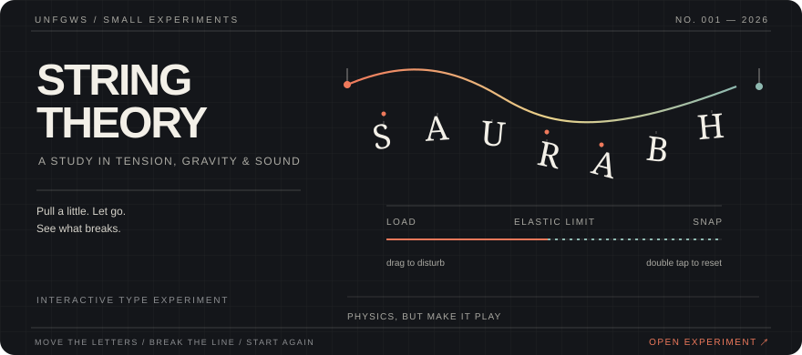

  

Playing with stuff. Making things I like.

Mostly small web projects: a blog, a physics toy, a page that links to everywhere else I am.

[Website](https://unfgws.pages.dev) &nbsp;/&nbsp; [Find me elsewhere](https://addme-saurb.pages.dev) &nbsp;/&nbsp; [Fun](https://unfgws.github.io/Fun/) &nbsp;/&nbsp; [Last.fm](https://www.last.fm/user/unfgws)

---

  FIELD STUDY / 001

  

  <i>Drag the letters. Pull until the line gives.</i> 
  <a href="https://unfgws.github.io/Fun/">Open the experiment ↗</a>

<!-- Codex co-authored -->
