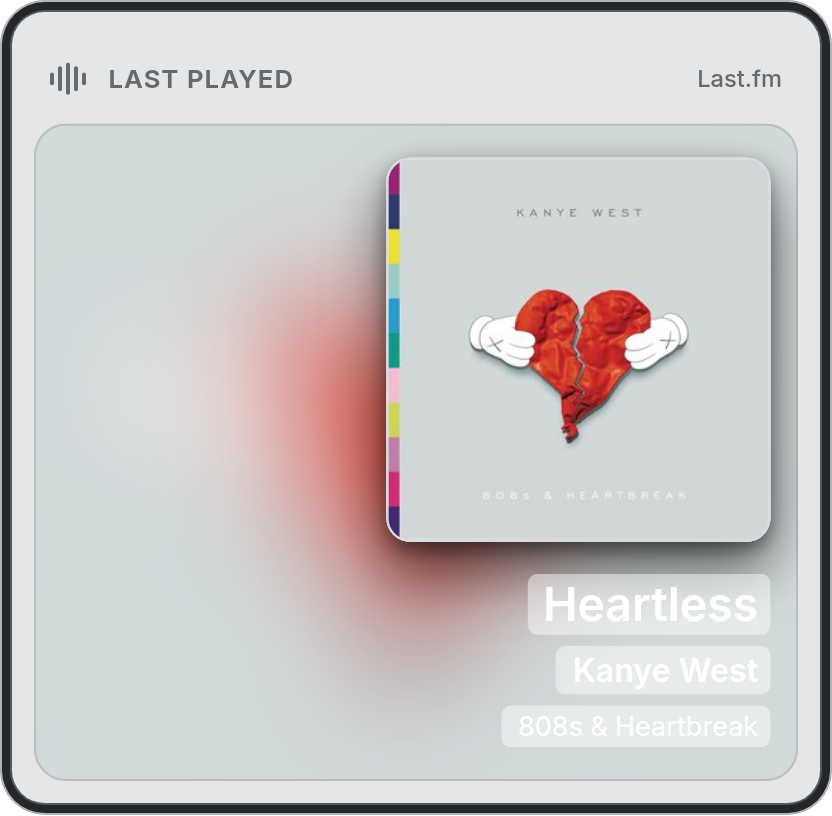
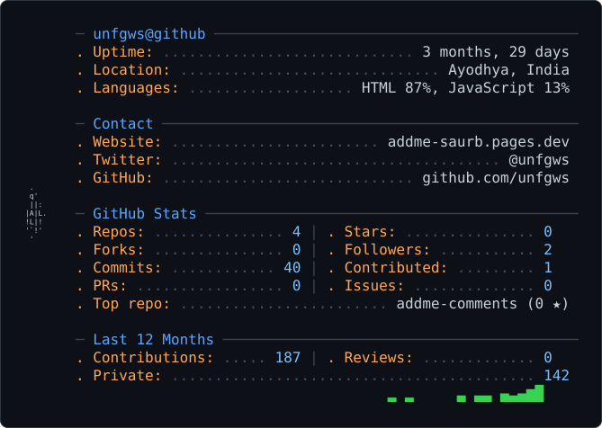

  

Well, hey 🐼

I am Saurabh.

And I'm here just for fun. As long as I enjoy it, I build/create some stuff.
or in a sense. I most of time need some organisation ,representation tool for my own work like blog publishing, library management ,media organisation etc So I need various tools for which sometimes I create sometime I use existing projects.

Well, nah, I'm not a coder.Niether the vibecoder in sense wanting to create the same project everyone's into. 

Rather what I need  like I wanted alot of music organisation tools for my music library,  then I wanted a simple addme page  etc etc , basically learn it one the go when I need stuff.

Anyways other than these ,I have a lot of ideas/projects, so I use Cli agents to help me out with code part while I deal with ideas/references ,I wrote about it on my addme website blog.  

Lately, I have been working on my Addme project (https://addme-saurb.pages.dev/misfit).

[Website](https://unfgws.pages.dev) &nbsp;/&nbsp; [Find me elsewhere](https://addme-saurb.pages.dev) &nbsp;/&nbsp; [Fun](https://unfgws.github.io/Fun/) &nbsp;/&nbsp; [Last.fm](https://www.last.fm/user/unfgws)

<picture>
  <source media="(prefers-color-scheme: dark)" srcset="dark_mode.svg" />
  <source media="(prefers-color-scheme: light)" srcset="light_mode.svg" />
  
</picture>

I'm always happy to connect with people and learn new stuff.
